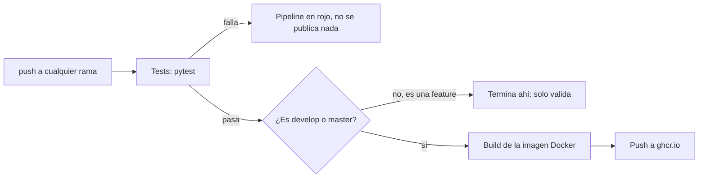

# Plantilla: Flask + CRUD + Postgres (dockerizado)

> ⚠️ **Esto es un punto de partida para aprender, no una entrega.** Es un
> esqueleto genérico (un CRUD de "tareas" de juguete) pensado para practicar
> Docker, Flask y Postgres antes de cursar. Si lo usás como base de un
> trabajo práctico, cambiá el modelo y la lógica por los de tu proyecto real:
> entregar esta plantilla sin modificar, vos o un compañero, es un riesgo de
> plagio y además no demuestra nada del trabajo propio.

Base reutilizable para cualquier entrega que pida "una app con CRUD sobre
una base de datos" (p. ej. el TPI de Seminario DevOps). Un solo recurso
(`tareas`) a propósito: demuestra el CRUD completo sin sobreingeniería.
Para un proyecto real, se cambia el modelo de `app.py` por el que corresponda
y el resto de la plantilla (Dockerfile, compose, patrón de rutas) se mantiene.

## Cómo correrlo

```bash
docker compose up -d --build
```

La API queda en `http://localhost:5000`. Postgres queda accesible en el
puerto `5432` (usuario `app`, contraseña `app`, base `app`) por si querés
inspeccionarla con un cliente como DBeaver o `psql`.

Para bajarlo todo (y borrar los datos de la base):

```bash
docker compose down -v
```

## Endpoints

| Método | Ruta | Qué hace |
|---|---|---|
| GET | `/` | Lista de endpoints disponibles |
| GET | `/tareas` | Lista todas las tareas |
| POST | `/tareas` | Crea una tarea. Body: `{"titulo": "...", "hecha": false}` |
| GET | `/tareas/<id>` | Trae una tarea puntual (404 si no existe) |
| PUT | `/tareas/<id>` | Actualiza `titulo` y/o `hecha` (404 si no existe) |
| DELETE | `/tareas/<id>` | Borra una tarea (404 si no existe, 204 si la borró) |

## Validaciones ya incluidas

- `titulo` vacío o ausente → 400.
- ID inexistente en GET/PUT/DELETE → 404.
- La app espera a que Postgres esté lista antes de crear las tablas
  (reintenta unos segundos en vez de romperse en el primer arranque).

## Tests (sin Docker)

```bash
python -m venv .venv
.venv\Scripts\activate          # Linux/Mac: source .venv/bin/activate
pip install -r requirements-dev.txt
pytest -v
```

Los tests usan una base SQLite descartable por test, así que corren sin
necesitar Docker ni Postgres levantados. Por eso `app.py` usa el patrón
"application factory" (`create_app`): la app de producción (Docker,
Postgres) y la de testing (SQLite) salen de la misma función, cambiando
solo la URL de conexión.

## CI/CD



El job de tests corre siempre, en cualquier rama. El de build-y-push
corre solo si los tests pasaron **y** la rama es `develop` o `master` —
así una rama `feature/*` a medio hacer nunca termina publicando una
imagen. No usa Postgres real: los tests corren contra SQLite, por eso el
pipeline no necesita levantar ningún servicio de base de datos.

## Flujo de ramas

`main` queda como la última versión estable. El trabajo nuevo entra por
`feature/*`, se integra primero a `develop`, y de `develop` a `main` cuando
ya está probado. Ejemplo real de este repo: la rama `feature/tests` agregó
los tests y se integró a `develop` por pull request.

## Estructura

- `app.py` — la API (Flask + SQLAlchemy), con `create_app()` para poder testear.
- `tests/test_app.py` — tests de los endpoints, con SQLite de prueba.
- `Dockerfile` — imagen de la API (producción, Postgres).
- `docker-compose.yml` — levanta la API y Postgres juntos.
- `requirements.txt` — dependencias de producción.
- `requirements-dev.txt` — las anteriores + pytest.
